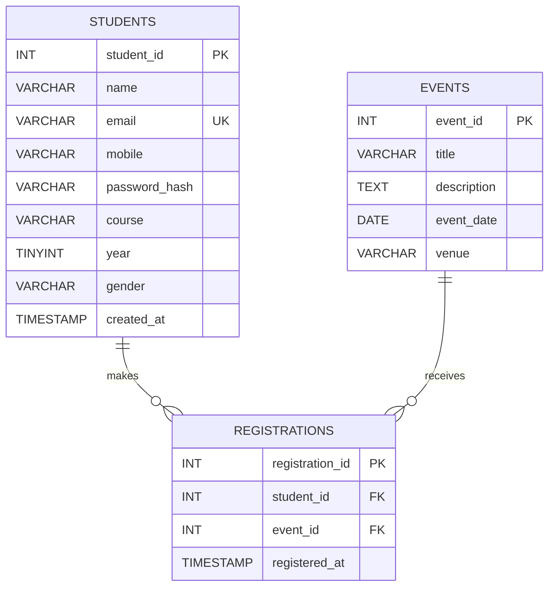

# StudentHub ER Model

StudentHub stores student details and event details separately. The
`registrations` table connects the two: a student can register for many events,
and an event can have many student registrations.

`student_id`, `event_id`, and `registration_id` are primary keys. The
registration table's `student_id` and `event_id` are foreign keys to their
respective parent tables. A unique constraint on `(student_id, event_id)`
prevents registering the same student for the same event more than once.
Student email addresses are also unique.

The junction table stores only the two references and registration time. It
does not repeat student names, contact details, or event descriptions in every
registration row. This reduces duplicate data and makes updates consistent.
Deleting a student or event deletes its dependent registrations.
